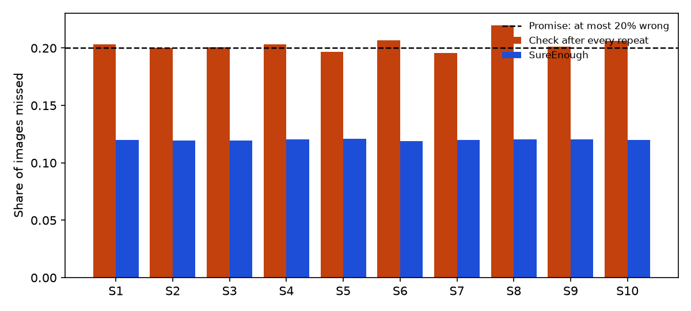
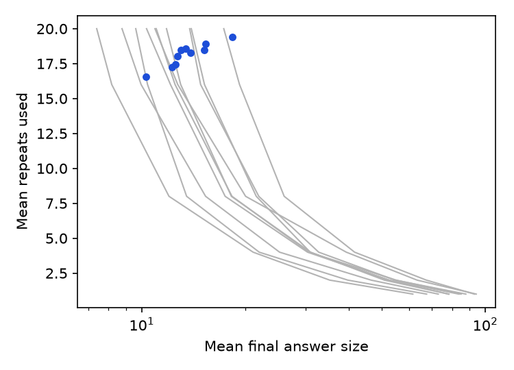

# SureEnough

**Brain decoders always guess. SureEnough knows when it has seen enough, says "not sure" when it isn't, and keeps its promise about how often it's wrong.**

**Live demo:** https://dmandaviya.github.io/SureEnough/

Built for the Meta Global AI Developer Hackathon (Indie track) on Meta Perception Encoder, SAM 3.1, Muse Spark and Muse Image.

---

## What SureEnough is

Today's brain decoders work like this: you record someone's brain activity while they look at a picture, and the decoder names its single best guess. It names a guess every time, even when the signal is mostly noise and the guess is almost random. Nothing tells you whether to trust it.

SureEnough is a layer that wraps around a brain decoder and changes what it promises:

1. **It decides when it has seen enough.** Brain recordings are noisy, so each picture is shown several times (repeats). SureEnough replays these repeats one at a time. After every repeat it asks *"am I sure enough to answer?"* and stops as soon as it is.
2. **It says "not sure" honestly.** When the evidence stays weak, it keeps listening. If it still isn't sure when it runs out of repeats, it doesn't fake a confident answer. It answers with a list ("it's one of these 17").
3. **It keeps a checked promise about how often it is wrong.** For each person: **the true object is outside SureEnough's final answer at most 2 in 10 times**, certified with 90% confidence. That covers the whole stop-when-sure procedure, including the fact that it checked after every repeat.

The answer comes in three shapes, from boldest to most cautious:

| Shape | Example | When |
|---|---|---|
| One object | "It's a handbrake." | The answer narrowed to a single object |
| A category | "It's an animal." | Every object in the answer shares one of the 53 THINGS categories |
| A list | "It's one of these 17." | Anything else |

### A real example (person 10, from the demo)

The person saw a **handbrake**. After the first repeat, 12 of the 200 candidate objects were still plausible. After the second repeat, only one was left. SureEnough stopped after 2 of its 20 repeats and said *"It's a handbrake."* Muse Spark phrased it as *"The person saw a handbrake."*

For the same person, a **banana** never got clear. The shortlist stayed between 6 and 20 objects for all 20 repeats, and the decoder's top pick at the end was garlic. SureEnough did not say "garlic". It used the full budget and answered *"It's one of these 17."* The banana was on that list.

### Why stopping as soon as you're confident is a trap

The obvious approach is "calibrate a confidence threshold, check after every repeat, stop the first time you cross it." Every extra check is one more chance to stop on a wrong answer that happened to look confident. The errors pile up:

- **Naive repeated look:** it promised at most 20% wrong. It delivered **20.3% on average**, and went over the promise for **8 of 10 people** (up to 22.0% for person 8).
- **The textbook fix (Bonferroni):** divide the error budget across all 20 checks. That is safe (**0.5% wrong**), but so cautious that it almost never stops early (**19.9 of 20 repeats**).
- **Top pick only:** name the decoder's best guess, stopping early only once it is 80% confident. This **missed 60% of the time**.

SureEnough avoids the trap by calibrating the entire procedure as one unit with Learn-then-Test (Angelopoulos et al., 2021). The promise is measured after the stopping rule has run, so the peeking is already priced in.

---

## Results

**Setup.**
- **Data:** 10 people from THINGS-EEG2, 200 held-out objects per person. Each object's 80 recorded repeats were replayed in 10 random orders.
- **Settings:** a budget of K = 20 repeats, the promise α = 0.2 (at most 2 in 10 wrong) and confidence 1 − δ = 0.9.
- **Testing:** every number comes from 1,000 random calibration/evaluation splits per person (100 images to calibrate, 100 to check).
- **Pre-registration:** the configuration (`configs/primary.json` and its sha256) was frozen and committed before any test data was calibrated.

### Headline

| | Result |
|---|---|
| **Promise kept** | **10 of 10 people.** Delivered error **11.8%** (95% CI 10.4–13.2%) on the pinned split, and **12.1%** averaged over all 1,000 splits, against the 20% promise. |
| Random splits | The deployed setting broke the promise in **0 of 1,000** splits, for every person. |
| Guarantee check (H2a) | A stricter test redrew the calibration set 1,000 times per person. The promise failed **5 times in 10,000** draws in total, **at most 0.9%** for any person (95% upper bound). It is allowed to fail **10%** of the time. |
| Naive repeated look (H2b) | Over the promise for **8 of 10** people, **20.3%** wrong on average. The sign test gives p = 0.055, so this is **not significant** after Holm correction. |
| Bonferroni repeated look | **0.5%** wrong, but stops at **19.9 of 20** repeats. |
| Top pick only | **60.4%** wrong. |
| **Stopping early (H1)** | **Not met.** For the median person, SureEnough used **1.22×** the repeats of the best fixed-repeat rule giving the same answer size. The pre-registered target was 0.7× or less (Wilcoxon p = 1.0). |
| Effort | Mean stop **18.2 of 20** repeats. Mean answer **13.8 of 200** objects. Both on the pinned split; the 1,000-split averages are 18.1 and 13.7. |
| Answer shapes | **1.7%** one object, **9.0%** a category, **89.3%** a list. |
| **Hedged pictures (H5a)** | **Met.** p = 0.002, significant after Holm correction. Details below. |



### Per person

Delivered error is the share of held-out images whose true object was not in the final answer, averaged over 1,000 splits.

| Person | SureEnough error | Naive error | Top-pick error | Mean stop (of 20) | Mean answer size | Repeats vs best fixed rule | Guarantee-check failures (of 1,000) |
|---:|---:|---:|---:|---:|---:|---:|---:|
| 1 | 12.1% | 20.3% | 61.1% | 18.5 | 13.0 | 1.21× | 0 |
| 2 | 12.0% | 20.0% | 62.8% | 18.9 | 15.3 | 1.22× | 1 |
| 3 | 12.0% | 20.1% | 58.7% | 18.3 | 13.8 | 1.24× | 0 |
| 4 | 12.1% | 20.3% | 63.1% | 18.0 | 12.7 | 1.19× | 0 |
| 5 | 12.2% | 19.7% | 68.7% | 19.4 | 18.4 | 1.08× | 3 |
| 6 | 11.9% | 20.7% | 52.2% | 17.5 | 12.6 | 1.44× | 0 |
| 7 | 12.1% | 19.6% | 66.3% | 18.5 | 15.2 | 1.15× | 0 |
| 8 | 12.2% | 22.0% | 54.2% | 16.6 | 10.3 | 1.43× | 0 |
| 9 | 12.1% | 20.1% | 61.2% | 18.6 | 13.4 | 1.22× | 1 |
| 10 | 12.1% | 20.6% | 56.3% | 17.2 | 12.2 | 1.53× | 0 |
| **Mean** | **12.1%** | **20.3%** | **60.4%** | **18.1** | **13.7** | **1.22× (median)** | **5 total** |

### Pre-registered hypotheses

| Hypothesis | Test | p | Holm | Verdict |
|---|---|---:|:---:|---|
| H1: stopping early needs at most 0.7× the repeats of the best fixed rule at equal answer size | Wilcoxon signed-rank, 10 people | 1.0 | — | Not met (1.22×) |
| H2a: the promise holds | 1,000 redrawn calibration sets per person, Clopper–Pearson bound | — | — | Met (≤ 0.9% failure vs 10% allowed) |
| H2b: the naive repeated look breaks the promise | Sign test, 10 people | 0.055 | Not significant | 8 of 10 over, not significant |
| H5a: when the top pick is wrong, the hedged picture is closer to the truth than the top-pick picture | Paired Wilcoxon, DINOv2 similarity | 0.002 | Significant | Met |

### Why stopping early did not pay off

The H1 result is a property of today's EEG, not of the calibration. A single repeat of 17-channel lab EEG carries very little information. For a decoder to put the right object inside a short answer often enough to promise 80% coverage, it needs almost all 20 repeats. A fixed rule that always looks at 16 to 20 repeats is already close to optimal.

The figure below shows this. Each grey curve is one person's fixed-repeat rules (1, 2, 4, 8, 16 and 20 repeats), plotted as repeats used against the answer size each rule gives. Each blue dot is SureEnough for that person. The dots sit at or above the curves.



The method does not depend on the decoder. A stronger decoder plugs in unchanged and keeps the same promise. Whether that decoder would then stop early is an open question this dataset cannot answer.

### Hedged pictures (H5a)

For persons 6 and 10, SAM 3.1 cutouts of every candidate in the answer were blended by likelihood. The test used the 101 held-out images where the top pick was wrong. Similarity to the true object's cutout was measured in DINOv2-L space, an independent model:

| Picture | Mean DINOv2 similarity to the truth |
|---|---:|
| Blend of the hedged answer | **0.063** |
| Top pick alone | 0.028 |
| Hedged answer for a different image (control) | 0.019 |
| The true object's own cutout (ceiling) | 0.58 |

The hedged blend is closer to the truth (paired Wilcoxon p = 0.0023, significant after Holm correction), but the effect is small next to the ceiling. Muse Image paintings of the same answers show the same direction: 0.073 vs 0.031 (n = 96, p = 0.003). This was a secondary check.

### The decoder

All decoder numbers below were measured after the freeze and are exploratory.

| Measure (200-way, mean of 10 people) | Top-1 | Top-5 |
|---|---:|---:|
| Official test images, 4 repeats averaged | 23.7% | — |
| Official test images, 20 repeats averaged | 41.1% | — |
| Official test images, all 80 repeats averaged | 46.0% | 80.1% |
| Concept-disjoint validation, 4 repeats (used for every decoder choice) | 25.2% | — |

Recent preprints report about 53–57% top-1 at 80 repeats, so this decoder is good but not state of the art.

**Which image space to decode into.** A linear (ridge) decoder was fitted from EEG to 14 candidate image spaces on concept-disjoint validation data. This used persons 1–3 at 4 repeats, and chance is 0.5%. "Mean" is the mean of the patch tokens; "CLS" is the class token.

| Perception Encoder block | Mean | CLS |
|---|---:|---:|
| 6 | 7.8% | 8.0% |
| **7 (chosen: mean)** | **8.5%** | 8.1% |
| 8 | 6.7% | 7.8% |
| 9 | 4.6% | 7.4% |
| 10 | 3.4% | 6.7% |
| 11 | 2.7% | 4.5% |
| Final embedding | 4.1% | |
| *CLIP-H final embedding* | *3.4%* | |

A middle layer of Perception Encoder decodes **2.5×** better than CLIP-H and **2×** better than Perception Encoder's own final layer. That fits the brain's visual cortex carrying mid-level visual features more than abstract labels.

---

## How it works

```
EEG repeat ──► decoder ──► Perception Encoder space ──► probabilities over 200 objects
                                                                │
           after each repeat: do the top 3 objects cover ≥ λ of the probability?
                       │ yes: stop                        │ no: next repeat (up to 20)
                       ▼                                  ▼
       answer = smallest set of objects covering λ  →  one object / a category / a list
                       │
   SAM 3.1 cutouts blended by likelihood · Muse Spark sentence · Muse Image painting
```

1. **Decode.** A small per-person convolutional encoder takes one flash of EEG and maps it into Perception Encoder space. The flash is 17 occipital and parietal channels by 100 time samples. The encoder is a temporal convolution, then a spatial convolution across channels, then a projection with a residual head. The target is block 7 of Perception Encoder Core B/16 (mean of patch tokens), and it is trained contrastively. It is trained on 1,654 training concepts, none of which appear among the 200 test objects. SureEnough averages the EEG of the repeats seen so far, embeds it, and compares the embedding with the 200 candidate objects. A softmax over the z-scored similarities turns that into a probability for each object. Its sharpness β (1.94–2.45 per person) is fitted on validation data.
2. **Replay.** Each held-out image has 80 recorded repeats. These are replayed in 10 fixed random orders (seed 20261030). After every repeat, the decoder ranks the 200 objects again.
3. **Stop rule.** One dial λ (between 0 and 1) controls caution. SureEnough stops at the first repeat where the top m = 3 objects cover at least λ of the probability. If that never happens, it stops at repeat 20. The answer is the smallest set of objects covering λ.
4. **Calibrate (Learn-then-Test).**
   - For each dial setting on a grid of 500 values from 1.0 down to 0.002, it tests "this setting breaks the promise" on the 100 calibration images. The test is a Hoeffding–Bentkus p-value on the miss rate, measured after the whole stop rule runs, averaged over the 10 replay orders.
   - Settings are tested in order from most cautious to boldest (fixed-sequence testing). It deploys the boldest setting rejected before the first one that is not.
   - This controls the chance of picking a promise-breaking setting at δ = 10%, with no multiple-testing penalty.
   - The deployed dial ended at λ ≈ 0.62–0.76 depending on the person.
5. **Check.** The other 100 images measure the delivered error. This repeats for 1,000 random splits per person.
6. **Show.**
   - **SAM 3.1:** cuts each candidate object out of a public-domain photo. The demo blends the cutouts by likelihood, so the picture sharpens as the answer narrows.
   - **Muse Spark:** restates the calibrated claim as one sentence.
   - **Muse Image:** paints an artist's impression of the claim.

### The promise, stated exactly

For a given person, let *miss* mean "the true object is not in SureEnough's final answer". With probability at least **90%** over which 100 images were used to calibrate, the deployed setting has an expected miss rate of **at most 20%** on new images from that person. The expectation is taken over images and over the order of repeats.

The guarantee is per person and covers the average over images, not each single image. It assumes new images come from the same recording conditions as the calibration images.

### Keeping the words honest

Muse Spark may only restate the calibrated claim. Every sentence goes through an automatic faithfulness check against a vocabulary of all 1,854 THINGS object names and 53 categories. If a sentence names any object or category outside the claim, it is rejected and the plain claim is shown instead ("It's one of these 14."). The page says when this happened.

Of 200 sentences for persons 6 and 10, **99 passed** and **101 fell back** to the plain claim. Most fallbacks are long lists that the sentence cannot name in full.

---

## The demo site

https://dmandaviya.github.io/SureEnough/ is a static site. It runs on real exported results with no server and no API calls from the browser.

**Demo page**
- Pick a mystery image, or one of the labelled replays: *Clean stop*, *Unsure*, *Hedged, top pick wrong*, *Missed*.
- Watch the replay repeat by repeat. The shortlist shrinks or holds, the blended SAM 3.1 picture sharpens, and SureEnough stops when it is sure enough.
- Then see the Muse Spark sentence, the Muse Image painting, and the reveal of the true object.
- **Live recalibration** redraws a random calibration split and re-runs Learn-then-Test in your browser.
- Each example shows the exact Muse Spark request and response, and the SAM 3.1 request behind its picture.

**Results page**
- Promised vs delivered error for all 10 people, recalibrated live in the browser.
- A strictness switch for 1, 2 or 3 in 10. Only 2 in 10 was pre-registered; 1 and 3 are exploratory.
- The findings above.

**How it works page**
- The method in plain words, and the Meta stack.

---

## Meta models used

| Model | Access | Role | Calls | Cost |
|---|---|---|---:|---:|
| Perception Encoder Core B/16 | Open weights | The image space the EEG is decoded into; text tower for an open-vocabulary guess | local | — |
| SAM 3.1 | Meta Model API | Cuts each of the 200 candidate objects out of its public-domain photo | 240 | $0.60 |
| Muse Spark 1.3 | Meta Model API | Calibrated claim → one checked sentence; describes photos SAM could not segment from the plain name | 237 | $1.61 |
| Muse Image 1.0 | Meta Model API | Artist's impressions for the demo and the H5a check (1,494 images; 5 content-policy refusals skipped) | 501 | $15.01 |
| DINOv2-L | Open weights | Independent scoring space for the pictures | local | — |
| **Total** | | | **978** | **$17.22** |

The API client logs every call to a local ledger before sending it. It refuses any call that would take tracked spend past $60. Requests are sent with `store: false`.

---

## Honesty notes and limitations

- **Replayed, not live.** This is public lab EEG (THINGS-EEG2), replayed. Each repeat is a 100 ms flash in a rapid sequence. A person's repeats of one image were recorded in 4 sessions on different days, so "repeats" never means seconds of one viewing.
- **Stopping early did not save repeats** with this decoder (H1 not met). The promise holds; the efficiency gain does not, yet.
- **The naive baseline's failure is borderline.** It is 20.3% against 20%, and not significant after correction (p = 0.055).
- **Calibration is per person** and needs about 100 labelled images from that person. The promise covers the average over images, not every single image.
- **The pictures are concept-level stand-ins.** They are public-domain CC0 photos of the same kind of object. The real stimulus photos are research-only. They are never shown, never sent to any service and never redistributed; the export checks every published image against the stimulus file hashes.
- **The open-vocabulary guess** from Perception Encoder's text tower is shown for curiosity only. It is not covered by the promise.
- **Every decoder choice** (architecture, target layer, training settings) was made on a concept-disjoint validation split before any test data was used.
- **Muse Image** declined 5 of the requested paintings under its content policy. Those were skipped, not retried with altered prompts.

### Prior work

A prior-work check on Nov 3, 2026 found no published method that decides per image when to stop *and* guarantees the error rate of the whole stopping procedure. The closest work:
- Bayesian dynamic stopping for c-VEP spellers (Ahmadi, Desain & Thielen, 2024): stops early, but does not certify the error of the stopping rule.
- Few-repeat EEG image retrieval at a fixed repeat count (NEAR, arXiv 2608.19128).
- Early time-series classification with risk control (Ringel et al., arXiv 2402.00857): risk control for early stopping, not applied to brain decoding or set-valued answers.

---

## Repository

```
configs/            frozen primary configuration and its sha256
scripts/            numbered pipeline, 00_smoke_api.py → 11_headline.py
sureenough/
  data/             THINGS-EEG2 conversion, concepts and categories, safe .npy loading
  features/         Perception Encoder, CLIP-H and DINOv2 features
  models/           convolutional EEG encoder, ridge baseline, retrieval, model store
  streams/          repeat replay orders and per-repeat probabilities
  calibrate/        stop rule and answer sets, Learn-then-Test, Hoeffding–Bentkus p-values, baselines
  analysis/         splits, hypotheses H1/H2a/H2b/H5a, headline numbers, figures
  narrate/          answer shapes, Muse Spark narration, faithfulness check
  visuals/          SAM 3.1 cutouts, blends, Muse Image conditions
  export/           web bundle export and checks
  meta_api.py       Meta Model API client with spend cap and ledger
tests/              159 Python tests
web/                Vite + React + TypeScript demo (80 unit tests, 9 browser tests)
assets/             figures used in this README
```

## Reproduce

Requirements: Python 3.14, Node 24, about 15 GB of disk. Everything installs inside the project (`.venv`, `web/node_modules`).

```bash
python -m venv .venv
.venv/Scripts/python -m pip install -e ".[dev]"

.venv/Scripts/python -I scripts/01_convert.py
.venv/Scripts/python -I scripts/02_pe_features.py
.venv/Scripts/python scripts/03_train.py --sweep --arch tsconv
.venv/Scripts/python scripts/03_train.py --all --target L7_mean --arch tsconv
.venv/Scripts/python scripts/04_streams.py --freeze L7_mean --arch tsconv
.venv/Scripts/python scripts/04_streams.py --streams
.venv/Scripts/python scripts/05_calibrate.py
.venv/Scripts/python scripts/11_headline.py
```

- `04_streams.py --streams` refuses to run until `configs/primary.json` is committed and every decoder matches its frozen sha256.
- `11_headline.py` recomputes the headline numbers from the cached per-image tables and checks them against `outputs/results.json`. It takes about a minute.

The visuals and the site use these steps:

```bash
.venv/Scripts/python scripts/06_sam_cutouts.py
.venv/Scripts/python scripts/07_demo_visuals.py
.venv/Scripts/python scripts/08_h5a.py
.venv/Scripts/python -I scripts/10_export.py
cd web && npm ci && npm run build
```

The Meta Model API steps (`00`, `06`, `07`) need a key in `.env` as `META_API_KEY`.

Tests:

```bash
.venv/Scripts/python -m pytest
cd web && npm test && npm run e2e
```

## Data and licences

- EEG: THINGS-EEG2 (Gifford et al., 2022), CC BY 4.0.
- Object photos shown publicly: THINGSplus, CC0.
- THINGS concept and category metadata: CC BY.
- THINGS stimulus images: research use only. They are used locally for training targets and scoring, and never redistributed.

## Author

Dhruvil Mandaviya
